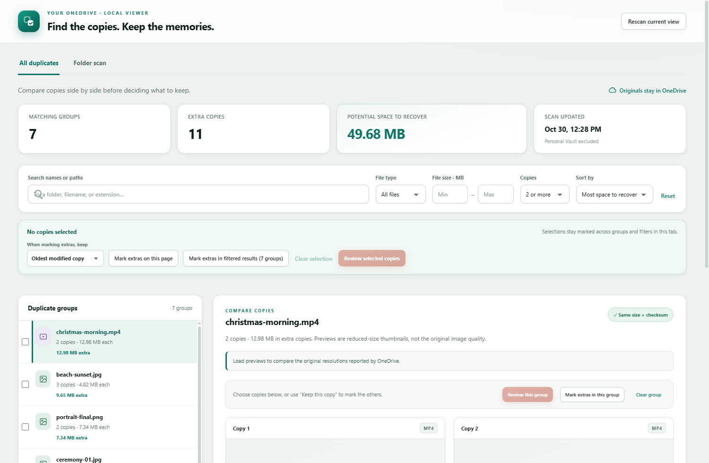

# OneDrive Duplicate Viewer

A local viewer that finds duplicate files in your OneDrive and lets you compare the copies side by side — thumbnails, resolution, dates, and paths — before you decide what to keep. Deletion is explicit, reversible, and verified: selected copies go to the **OneDrive Recycle Bin**, never permanent delete.

It runs entirely on your machine as a small Python web server. No framework, no build step, no database — the Python standard library and a bit of vanilla JavaScript.

<picture>
  <source media="(prefers-color-scheme: dark)" srcset="docs/screenshot-dark.png">
  
</picture>

## Features

- **Duplicate groups** — files with identical checksums grouped together, sorted by recoverable space
- **Two scan modes** — whole-drive scan, or targeted folder scan with a built-in OneDrive folder browser
- **Side-by-side comparison** — real thumbnails, resolution, duration, modified dates, and paths for every copy
- **Filter and sort** — by name, file type, size, and copy count; stale copies flagged when files change after a scan
- **Bulk mark-extras** — keep oldest / newest / shortest path, or mark copies one by one
- **Review before delete** — a confirmation dialog shows the exact keep and remove lists, then moves copies to the Recycle Bin
- **Light and dark themes** — follows your system, with a responsive layout down to mobile widths

## "Wait, what does this actually do?"

Nothing you couldn't do by hand — it just makes it pleasant. The viewer wraps two things:

- **`rclone dedupe`** (in `--dry-run` mode) to list groups of identical files in your OneDrive, whole drive or one folder at a time. Read-only: the scan never touches your files.
- **Microsoft Graph API** to fetch small thumbnails and metadata for the copies you open, and to move reviewed copies to the Recycle Bin.

Your files stay in OneDrive. The only writes are the scans you trigger and the deletions you confirm path-by-path.

## Requirements

> [!WARNING]
> **Windows only.** The viewer expects Python and an rclone OneDrive remote on the machine that runs it.

- **Python 3.10+** — standard library only, `pip install` is never needed
- **[rclone](https://rclone.org)** installed via WinGet — the viewer looks for `rclone.exe` at `%LOCALAPPDATA%\Microsoft\WinGet\Links\rclone.exe`
- An rclone remote named **`onedrive`** configured at `%APPDATA%\rclone\rclone.conf` (OneDrive Personal; Personal Vault is excluded)

## Install

```powershell
winget install Python.Python.3.13
winget install Rclone.Rclone
rclone config        # create a remote named "onedrive", type: onedrive
```

Then clone or download this folder. That's it — no dependencies to install.

## Run

```powershell
python server.py --open-browser
```

The server picks a free localhost port, generates a one-time secret, and opens the viewer in your browser. Leave the console window open while you use it; close it (or Ctrl+C) to stop.

- Run the same command again to reopen the viewer — it detects the running instance and reuses its session.
- `python server.py --port 8787 --open-browser` pins a specific port.
- Scan results live in `%LOCALAPPDATA%\OneDrive Duplicate Scanner\` (`last-scan.txt`, `folder-scans\`), so the viewer opens instantly on previous results before you rescan.

## Using it

1. **All duplicates** — the saved whole-drive scan. **Rescan current view** runs a fresh `rclone dedupe` in the background.
2. **Folder scan** — browse your OneDrive folders and scan just one folder (faster, good for photo archives).
3. **Filter** by name/path, file type, size, and copy count; sort by recoverable space.
4. **Open a group** to load real thumbnails and metadata (resolution, duration, modified date) for each copy. Files that changed since the scan are flagged.
5. **Mark extras** — per copy, per group, or in bulk with a keep-rule (oldest / newest / shortest path).
6. **Review** the exact remove/keep lists in the confirmation dialog, then move selected copies to the Recycle Bin.

## Safety model

- Nothing is deleted from the list or card views — only the reviewed dialog deletes, and it shows every path first
- Recycle Bin only; files are recoverable from OneDrive
- Each file is re-verified (size + `quickXorHash` + eTag) at deletion time; changed files are skipped
- At least one copy in every group is always kept; a Stop button halts after the current group

## Security notes

- Binds to `127.0.0.1` only; a per-run secret is required in an `HttpOnly SameSite=Strict` cookie
- `Host` and `Origin` checks on every request; strict CSP; paths and signed URLs are never logged
- Thumbnails are fetched server-side and only from allowlisted Microsoft domains

## Project layout

| File | Role |
| --- | --- |
| `server.py` | Local HTTP server, Graph API client, scan orchestration, safe deletion |
| `folder_scans.py` | Read-only rclone scan runner for single folders |
| `index.html` / `style.css` | Viewer UI — light + dark themes, no build step |
| `app.mjs` / `model.mjs` | Frontend logic, filtering, selection, deletion plans |
| `test_server.py` / `test_folder_scans.py` | Python unit tests |
| `test_model.mjs` | Node tests for the frontend model |

## Tests

```powershell
python -m unittest test_server test_folder_scans
node test_model.mjs
```

## Notes

- Previews are reduced-size thumbnails, not originals — checksums identify duplicate *candidates*, not full visual-quality assessments.
- Scanning a large drive takes a while; folder scans are the fast path.
- This is a personal tool, not a Microsoft product. API changes or rclone differences may require small fixes.
